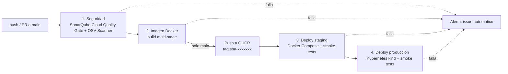

# evaluacion2devops — Pipeline CI/CD para `ms-vehiculos`

[](https://github.com/panda2048-max/evaluacion2devops/actions/workflows/ci-cd.yml)

Pipeline CI/CD en **GitHub Actions** que automatiza el ciclo de vida completo del microservicio
`ms-vehiculos` (Spring Boot 4 · Java 21 · MySQL): análisis de seguridad,
contenerización, publicación de la imagen y despliegue automático en dos entornos simulados
(Docker Compose y Kubernetes).

**Integrantes:** _<Fabrizio Morales>_ · _<Tomas Huiriqueo>_

---

## 1. Estructura del repositorio

```
.github/workflows/ci-cd.yml    Pipeline CI/CD
ms-vehiculos/
├── Dockerfile                 Imagen multi-stage, usuario no-root, healthcheck
├── .dockerignore
├── docker-compose.yml         Entorno "staging": app + MySQL
├── .env.example               Plantilla de variables (el .env real no se versiona)
├── k8s/                       Entorno "producción": manifiestos Kubernetes (kustomize)
│   ├── namespace.yaml         Namespace con Pod Security "restricted"
│   ├── configmap.yaml         Configuración no sensible
│   ├── mysql.yaml             StatefulSet + volumen persistente + Service headless
│   ├── deployment.yaml        2 réplicas, rolling update, probes, límites, securityContext
│   ├── service.yaml           Service ClusterIP
│   ├── hpa.yaml               Autoescalado 2–5 pods por CPU/memoria
│   ├── pdb.yaml               PodDisruptionBudget (mínimo 1 pod disponible)
│   └── networkpolicy.yaml     MySQL solo accesible desde la app
├── pom.xml                    Build Maven + JaCoCo con umbral de cobertura
└── src/                       Código y pruebas unitarias (se ejecutan localmente, fuera del pipeline)
```

## 2. Flujo del pipeline



Cada etapa depende de la anterior (`needs`): **si una etapa falla, las siguientes no se ejecutan**,
por lo que código con vulnerabilidades o que no arranca nunca llega a desplegarse.

| # | Job | Qué hace | Bloquea si… |
|---|-----|----------|-------------|
| 1 | Seguridad (SonarQube + dependencias) | Análisis estático del código en **SonarQube Cloud** (bugs, vulnerabilidades, *security hotspots*, *code smells*, duplicación) y escaneo de dependencias directas y transitivas con **OSV-Scanner** | el **Quality Gate** de SonarQube no se cumple o hay dependencias con vulnerabilidades conocidas |
| 2 | Imagen Docker | Construye la imagen multi-stage y la publica en GHCR | la imagen no compila |
| 3 | Deploy staging | `docker compose up --wait` con la imagen recién publicada + pruebas de humo (health, POST, GET, 404) | algún contenedor no queda *healthy* o falla una prueba de humo |
| 4 | Deploy producción | Crea un cluster Kubernetes (kind), aplica los manifiestos, espera el rollout + pruebas de humo | el rollout no termina o fallan las pruebas de humo |
| — | Alerta de fallo | Abre un *issue* con las etapas fallidas, el commit y el enlace a la ejecución | — |

> Las pruebas unitarias (JUnit/Mockito/MockMvc) se mantienen en el proyecto, pero **no se ejecutan
> en el pipeline**; se corren localmente con `./mvnw verify` (ver sección 8).

En los **Pull Requests** se ejecutan las etapas 1–2 (sin publicar ni desplegar), de modo que se
valida el cambio antes de mezclarlo en `main`.

## 3. Contenedores (Dockerfile)

- **Multi-stage**: la etapa `build` usa `eclipse-temurin:21-jdk-alpine` para compilar; la imagen
  final usa solo `eclipse-temurin:21-jre-alpine` (sin JDK ni Maven), lo que reduce tamaño y superficie de ataque.
- **Capas de Spring Boot** (`jarmode=tools extract --layers`): las dependencias quedan en una capa
  separada del código, así un cambio en el código no vuelve a descargar todas las dependencias.
- **Usuario no-root** (UID 1001) y `HEALTHCHECK` contra `/actuator/health`.
- **Memoria consciente del contenedor**: `-XX:MaxRAMPercentage=75` ajusta el heap al límite del contenedor.
- **Etiquetas OCI** (`org.opencontainers.image.revision`, `version`, `created`, `source`) que
  vinculan la imagen con el commit que la generó.

## 4. Orquestación

### Docker Compose (staging)
- Servicios `app` y `db` en una red interna; MySQL **no** se expone al host.
- `depends_on: condition: service_healthy`: la app solo arranca cuando MySQL responde.
- Límites de CPU/memoria, `restart: unless-stopped`, sistema de archivos de solo lectura y `no-new-privileges`.
- Credenciales por `.env` (no versionado); en el pipeline se generan aleatoriamente en cada ejecución.

### Kubernetes (producción simulada)
| Aspecto | Configuración |
|---|---|
| Disponibilidad | 2 réplicas, `RollingUpdate` con `maxUnavailable: 0` (sin downtime), PDB `minAvailable: 1` |
| Escalabilidad | HPA de 2 a 5 réplicas al 70 % de CPU / 80 % de memoria, con ventana anti-*flapping* de 5 min |
| Salud | `startupProbe`, `livenessProbe` y `readinessProbe` sobre los endpoints de Actuator; initContainer que espera a MySQL |
| Recursos | `requests` y `limits` de CPU/memoria en todos los contenedores |
| Seguridad | Pod Security `restricted`, `runAsNonRoot`, `readOnlyRootFilesystem`, `capabilities: drop ALL`, seccomp, sin token de ServiceAccount, NetworkPolicy, credenciales en `Secret` |
| Persistencia | MySQL como `StatefulSet` con `PersistentVolumeClaim` |
| Rollback | `revisionHistoryLimit: 5` + anotación `change-cause` → `kubectl rollout undo` |

## 5. Trazabilidad: del commit a producción

| Pregunta | Dónde se responde |
|---|---|
| ¿Qué commit está desplegado? | Tag de la imagen `sha-<commit>` y etiqueta OCI `org.opencontainers.image.revision` |
| ¿Qué imagen exacta se desplegó? | El **digest** inmutable se registra en el resumen de la ejecución (*Job summary*) |
| ¿Qué ejecución del pipeline hizo el despliegue? | Anotación `kubernetes.io/change-cause` del Deployment (commit + URL de la ejecución); `kubectl rollout history` |
| ¿Cuándo y en qué entorno? | Pestaña **Deployments / Environments** de GitHub (`staging`, `production`) |
| ¿Pasó el análisis de seguridad? | Dashboard del proyecto en SonarQube Cloud (historial de análisis por commit, enlazado en el *Job summary*) y log del paso OSV-Scanner |
| ¿Qué falló y quién lo provocó? | Issue automático con etiqueta `pipeline-failure`, commit, autor y enlace al log |

## 6. Calidad y seguridad

**Políticas de calidad**
- Pruebas de humo contra la aplicación **desplegada** en ambos entornos (health, alta, consulta y 404).
- El proyecto conserva pruebas unitarias de `VehiculoService` y `VehiculoController` con cobertura
  mínima de 80 % (`jacoco:check`), ejecutables localmente con `./mvnw verify` (fuera del pipeline).

**Políticas de seguridad**
- Código analizado con SonarQube Cloud usando el Quality Gate *Sonar way*; si no se cumple
  (`sonar.qualitygate.wait=true`) → bloqueo del pipeline. Como las pruebas no corren en el
  pipeline, la cobertura se excluye del análisis (`sonar.coverage.exclusions`).
- Dependencias escaneadas con OSV-Scanner contra la base de datos OSV; cualquier vulnerabilidad
  conocida → bloqueo. Las excepciones justificadas se registran en `ms-vehiculos/osv-scanner.toml`
  con fecha de expiración.
- SonarQube Cloud envía **notificaciones por correo** cuando el Quality Gate falla (configurable
  en *My Account → Notifications*), además del issue automático que crea el pipeline.
- Sin credenciales en el repositorio: se eliminaron la IP y la contraseña que estaban por defecto en
  `application.yml`; se usan `.env`, `Secret` de Kubernetes y *GitHub Secrets*.
- Actuator expone solo `health` e `info`.
- Permisos mínimos del `GITHUB_TOKEN` por job.

## 7. Configuración necesaria en GitHub

1. **Crear el proyecto en SonarQube Cloud**: entrar a <https://sonarcloud.io> con la cuenta de
   GitHub → *+ → Analyze new project* → importar `evaluacion2devops`.
2. **Desactivar el análisis automático**: en el proyecto, *Administration → Analysis Method →
   Automatic Analysis: OFF* (el análisis lo hace el pipeline; si queda activo, el paso falla).
3. **Secret `SONAR_TOKEN`**: en SonarQube Cloud, *My Account → Security → Generate Token*.
   Copiarlo en GitHub: *Settings → Secrets and variables → Actions → New repository secret*.
4. **Variables `SONAR_ORGANIZATION` y `SONAR_PROJECT_KEY`** (pestaña *Variables* de la misma
   pantalla), con los valores que muestra SonarQube Cloud en *Information* del proyecto.
   Si no se definen, el pipeline usa `panda2048-max` y `panda2048-max_evaluacion2devops`.
5. (Opcional) **Aprobación manual para producción**: *Settings → Environments → production →
   Required reviewers*. Así el despliegue a producción espera la aprobación de un integrante.
6. (Opcional) **Proteger `main`**: *Settings → Branches → Add rule* exigiendo que pasen los checks
   `1. Seguridad (SonarQube + dependencias)` y `2. Imagen Docker` antes de mezclar un PR.

## 8. Ejecución local

```bash
cd ms-vehiculos

# Pruebas + cobertura (reporte en target/site/jacoco/index.html)
./mvnw verify

# Entorno completo con Docker Compose
cp .env.example .env          # editar las claves
docker compose up -d --build --wait
curl http://localhost:9004/actuator/health
# Swagger UI: http://localhost:9004/swagger-ui.html
docker compose down -v

# Kubernetes local (kind / minikube / Docker Desktop)
docker build -t ms-vehiculos:latest .
kind load docker-image ms-vehiculos:latest      # solo si usas kind
kubectl apply -f k8s/namespace.yaml
kubectl -n vehiculos create secret generic vehiculos-db \
  --from-literal=DB_USERNAME=vehiculos \
  --from-literal=DB_PASSWORD=<clave> \
  --from-literal=DB_ROOT_PASSWORD=<clave-root>
kubectl apply -k k8s/
kubectl -n vehiculos port-forward svc/ms-vehiculos 8080:80
```

## 9. Justificación de decisiones técnicas

> A traves de Las practicas realizadas se prefirio ocupar Sonarqube Por mas faciliar y experiencia en el manejo de la herramienta

## 10. Uso de Inteligencia Artificial

> su ocupo Claude Code para la configuracion correcta del workflows y resolver dudas en momentos de fallos en el codigo

Cita según <https://bibliotecas.duoc.cl/ia>: _completar con el formato de la biblioteca_.

## 11. Conclusiones y reflexiones individuales

> ✍️ **Obligatorio, redactado por cada integrante sin apoyo de IA.**

### Reflexión de _<Fabrizio Morales>_
> como reflexion la manera que al diseñar bien un workflows con las herramientas como sonarQube.
>Ayudan realmente a facilitar el trabajo ya que terminamos automatizando todo y creando un metodo de informacion de errores por si ocuprre una falla

### Reflexión de _<Tomas Huiriqueo>_
_…aprendizaje y contribución al proyecto…_
